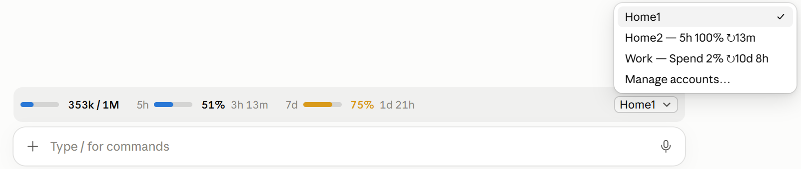
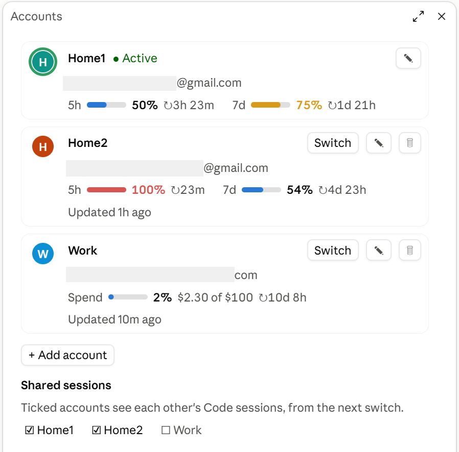

# Account Switcher for Claude Desktop

[](https://github.com/plexxed/claude-desktop-account-switcher/actions/workflows/ci.yml)
[](LICENSE)

Switch Claude Desktop on Windows between several Claude accounts in one click, and see each account's plan limits right above the prompt.





> [!WARNING]
> **Unofficial.** Anthropic doesn't make or support this mod. It swaps Claude Desktop's stored sign-in while the app is closed and reads two undocumented endpoints, so a Claude update can break it. Use it at your own risk.
>
> - **A switch restarts Claude.** Running tasks stop.
> - **Sign-ins stay on your computer,** encrypted by Claude for your Windows user. Nothing is sent anywhere but Claude's own requests to `api.anthropic.com`.

## What it does

- **Limits above the prompt:** the session's context, and the account's 5-hour and weekly limits with the time until they reset.
- **An account picker** in that band, showing the last limits seen for every account, so you know which one has room.
- **An Accounts list** (**Manage accounts…** in the picker) to add, rename, delete and switch accounts.
- **Switching in one click:** Claude closes, the other account's sign-in is swapped in, and Claude starts again. Settings, MCP servers and plugins stay as they are.
- **Shared Code sessions,** if you want them: tick accounts under **Shared sessions**, and their Code tabs show one list of sessions.

## Install

You need Windows 10 or 11, an up-to-date Claude Desktop, and Claude Code in a terminal. If `claude --version` doesn't work in PowerShell, install it first:

```powershell
irm https://claude.ai/install.ps1 | iex
```

Then install the mod, in PowerShell or CMD:

```powershell
claude plugin install account-switcher --marketplace plexxed/claude-desktop-account-switcher
```

Open a new Code session in Claude Desktop, and the band appears above the prompt. The account you're signed in to is saved first. Add the others with **+ Add account**: the first switch to a new one opens Claude's sign-in screen.

To update the mod, run `claude plugin update account-switcher@account-switcher`, then restart Claude Desktop. To uninstall it, run `claude plugin uninstall account-switcher@account-switcher`. Your saved sign-ins stay in `%USERPROFILE%\.claude\plugins\data\account-switcher\` until you delete that folder.

## Contributing

See [CONTRIBUTING.md](CONTRIBUTING.md). To report a vulnerability, see [SECURITY.md](SECURITY.md).

## License

[MIT](LICENSE)
